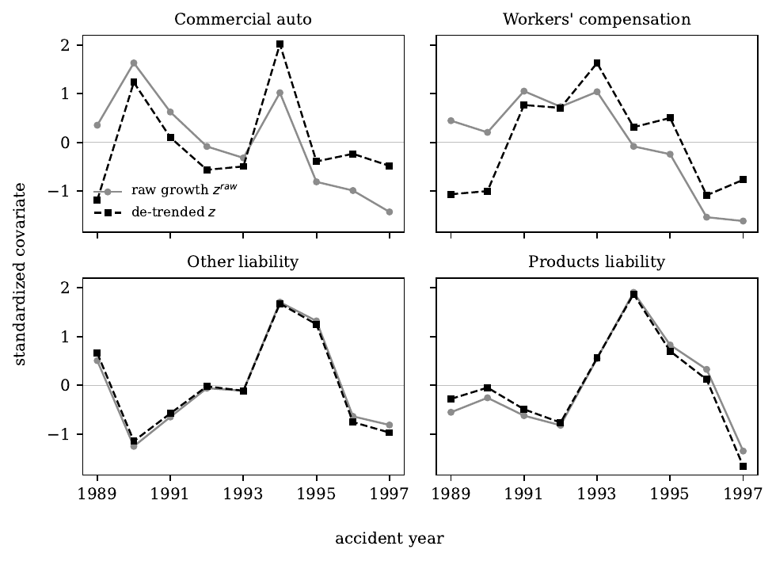

# Testing for Cycle-Dependent Loss Development in Long-Tail Casualty Business

Code for every table and figure of

> Aslan, I. (2026). Testing for cycle-dependent loss development in long-tail casualty business. Working paper. [SSRN 7144158](https://ssrn.com/abstract=7144158)



Reserving methods in the chain-ladder tradition treat the development of paid and case-incurred losses as invariant to the state of the underwriting cycle, although practitioners widely believe that soft-market accident years develop more adversely. The paper tests this directly. Development factors are regressed on observable, accident-year-dated market covariates within a log-normal development-factor model that nests the cycle-blind chain ladder. The data are the two public CAS Schedule P compilations: 426 company–line triangles with realised run-off, accident years 1988–2007, a span that contains the 2001–2004 hard market.

## Main results

- Raw premium growth appears associated with development, but a placebo line, rate-regulated private passenger auto, exposes the association as trend contamination.
- De-trended, the pooled cycle coefficient is indistinguishable from zero in both eras and on both bases (pooled 1988–2007: 0.0016, s.e. 0.0025). It vanishes under calendar-year controls, and hierarchical Bayesian re-estimation confirms the null.
- What replicates across eras is cross-sectional: companies growing faster than their line develop adversely.

## Files

| File | Content |
|---|---|
| `prepare_data.py` | Builds the flat era-A panel `data/cas_full_square.csv` from the CAS files |
| `code/01_era_a_paid_development.py` | Era A (1988–1997): screening, cycle covariates, paid-loss development regressions, placebo, booked-ultimate errors |
| `code/02_era_a_incurred_and_out_of_sample.py` | Era A: incurred-loss development, one-year-ahead out-of-sample test, booked-error tests |
| `code/03_exhibits_era_a.py` | Figure 1 (`fig1_covariates`) and Figure 3 (`fig2_lag_profile`, lag-specific coefficients); tables of the main estimates, the out-of-sample test and the panel |
| `code/04_bayes_msep_robustness.py` | Hierarchical Bayesian model (Gibbs sampler), PIT calibration, reserve MSEP, robustness |
| `code/05_tables_bayes_msep_robustness.py` | Tables of the Bayesian estimates, the MSEP and the robustness checks |
| `code/06_era_b_and_pooled.py` | Era B (1998–2007) and the pooled two-era analysis |
| `code/07_era_b_robustness.py` | Era B: calendar-year fixed effects, booked-error test at early valuations, Gibbs re-estimation |
| `code/08_exhibits_era_b.py` | Figure 2 (`fig3_covariates_eraB`, era-B covariates) and the era-B, robustness and panel tables |
| `code/09_pit_era_b.py` | Era B: PIT calibration |
| `results/` | Estimates (CSV), console output of each script (`log_*.txt`), LaTeX tables (`tables/`) and figures (`figures/`) |

## Running the code

1. Download the CAS data and save the files as described in [`data/README.md`](data/README.md).
2. From the repository folder:

```
python -m pip install -r requirements.txt
python prepare_data.py
python code/01_era_a_paid_development.py
python code/02_era_a_incurred_and_out_of_sample.py
python code/03_exhibits_era_a.py
python code/04_bayes_msep_robustness.py
python code/05_tables_bayes_msep_robustness.py
python code/06_era_b_and_pooled.py
python code/07_era_b_robustness.py
python code/08_exhibits_era_b.py
python code/09_pit_era_b.py
```

The whole sequence runs in under a minute. Every estimate other than the Bayesian posterior is deterministic and reproduces the files in `results/` to within floating-point rounding (relative differences below 10⁻¹⁰).

The Gibbs sampler uses a fixed seed, but its multivariate normal draws pass through the machine's linear-algebra library. Posterior summaries can therefore differ in the last reported digit across machines: one posterior probability is 0.58 in the paper and can come out as 0.59. `results/bayes_posterior.csv` and `results/bayes_eraB.txt` are the draws reported in the paper.

The code was last checked with Python 3.13, pandas 3.0, NumPy 2.5, SciPy 1.18, statsmodels 0.15 and Matplotlib 3.11.

## Citation

Please cite the paper. GitHub's "Cite this repository" button gives the reference in APA and BibTeX formats.

## Licence

Code: MIT licence (see `LICENSE`). The CAS data are not included; see `data/README.md`.

## Author

Ilker Aslan, Lecturer, Kalaidos University of Applied Sciences, Zürich
[ORCID 0000-0001-9241-9420](https://orcid.org/0000-0001-9241-9420) · [ilkeraslan.github.io](https://ilkeraslan.github.io)
